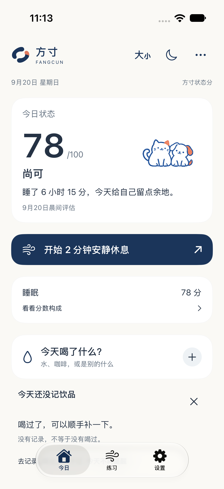
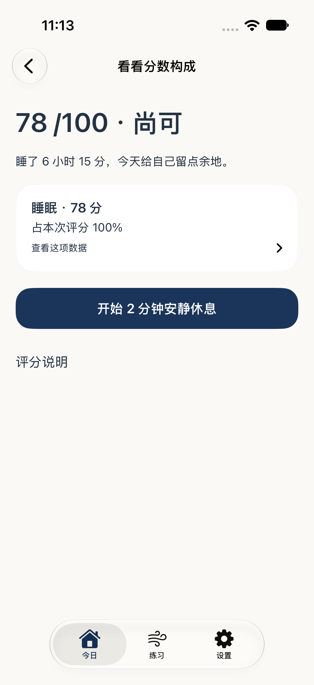
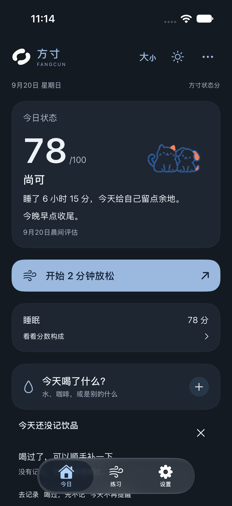

# 方寸 V3 · 分数优先重做

**可靠睡眠 6 小时 15 分、目标 8 小时，即使没有 HRV 和成熟心率基线，正式原生首页也显示 78 分「尚可」。** 输入从合成原始睡眠，经 provider、独立评分引擎和持久化到 SwiftUI；不是在页面上写死 78，也没有把旧准备度等级映射为数字。

以下是最终原生模拟器中的真实操作录像，使用合成数据，按实际画面截取并保持原速；不是静态稿或重绘动画。

| 首页与真实轻行动 | 饮品与业务反馈 | 呼吸与暂停 |
| --- | --- | --- |
| [78 → 实际构成 → 两分钟休息](evidence/S4-home-action.mp4) | [记水、咖啡、酒精与撤销](evidence/S4-drinks.mp4) | [首页 → 双吸一呼 → 暂停和结束](evidence/S4-breathing.mp4) |

[S1 首次贯通的完整记录](evidence/S1-native-flow.mp4) 作为阶段证据保留。录像没有个人健康数据。

| 默认构成详情 | 23:22 夜间建议，分数仍为 78 |
| --- | --- |
|  |  |

## 本轮改变

- 新增独立版本 `fangcun-status-3.0`：睡眠直接可算，HRV 与静息心率按独立资料和渐进质量权重加入；未用维度不填 0。原参数和 24 组 fixtures 按开发包保留。这些是待校准的工程规则，不是已经验证的医学标准。
- 睡眠指标完成初始化即可先发布；其他指标失败不会拿掉已有有效成分并悄悄重算。来源、目标、晚到记录和删除都有修订、依赖及故障恢复路径。
- 默认详情展示实际参与维度和归一化权重；说明主动展开。新数值历史与旧准备度记录隔离，旧日期不造分，组成变化不伪装成状态涨跌。
- 夜间、驾驶/不便行动、明确不想呼吸和不适反馈改变主动作。五分钟呼吸仍可达，轻行动和反馈保存真实记录，不奖励分数。
- 可在本地补记睡眠，且不用先授予健康权限。后来明确选择 HealthKit 主睡眠，会替代当前手工输入；历史快照保留。
- 原画、业务动效、饮品剂量/时间/撤销、关怀、既有练习及用户记录保留。跨端只新增协商过的最小数值摘要；旧端撤回旧摘要，不硬映射。

## 验证与边界

实际命令、正常退出码、失败原因及 V301–V328 对应证据见 [VERIFICATION.md](VERIFICATION.md)。Core **162** 项、App 全量 **198** 项通过；完整 UI 与后续复验合计 **54** 个独立用例均有最新通过证据，最终重点验收 **14** 项全部通过，命令正常退出 0、结果包可读取。Watch 模拟器编译和 iOS 签名 Release 通过。首轮和中间失败分别保留，未删除断言或跳过用例。

手机回读确认已安装 **1.0.0（2026092002）**；安装回执曾连接中断，但之后独立读取版本成功。覆盖前后 **13 个应用数据文件逐字节一致，偏好值一致**，未卸载或清库。启动检查因手机锁屏被系统拒绝，因此真实健康数据刷新仍未验证。

原始 `.xcresult`、安装回执、设备标识、签名和健康存档仅保存在本机私有验收目录；仓库只包含合成画面、测试源代码和脱敏结果摘要。人工审美、三秒认知效率与真实健康场景不是自动化断言可替代的验收；Watch 真机后台和同步仍未验证。

逐文件范围见 [CHANGED_FILES.md](CHANGED_FILES.md)，可重放场景映射见 [VERIFICATION.md](VERIFICATION.md)。

## 变更及提交

基准：`7d2f87ef46c625fda2549649879fb18367a0e766`。沿用 `codex/fangcun-v1-m0-m1`，不覆盖后续有效工作，不合并 main、不强推、不上架。

| 阶段 | 提交 |
| --- | --- |
| S0 契约切换 | `3f0e4fe` |
| S1 原生数值切片 | `79ea25b` |
| S2 数据、引擎、存储和 DTO | `6315843` |
| S3 历史、行动、记录与界面契约 | `3b1ac7e` |
| S4 验证、必要修复、画面和安装证据 | 本文所在交付提交，最终 SHA 由分支回读提供 |

本轮完成后停在 V3，不进入 Watch / Widget / Live Activity 新功能阶段。

最大字号截图：[实际布局](evidence/S4-maximum-type.png)。品牌和工具栏不重叠，正文按系统字号放大，可滚动到达主行动；极大字号不是把所有内容硬塞进一屏。
